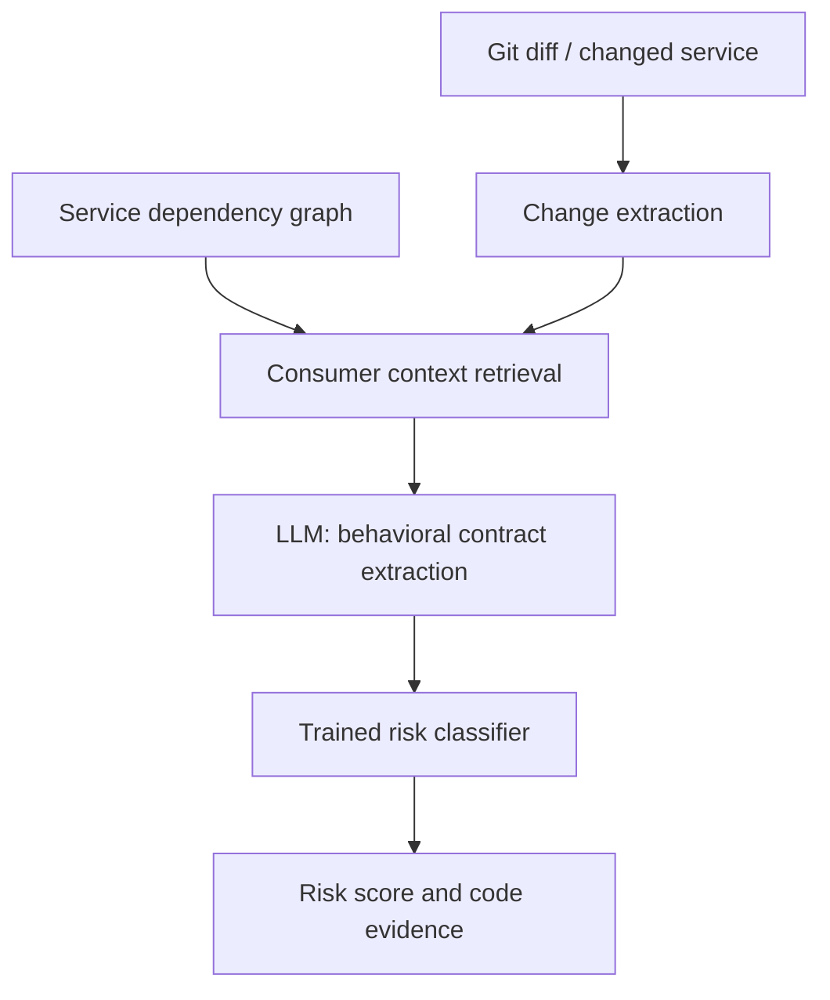

# Semantic Firewall

**Predicting cross-service behavioral regressions from code changes.**

> **Status:** Early-stage research / ML System Design project. The detection pipeline, dataset, and demo microservices described below are **planned**, not yet implemented.

## The problem

A service can change its behavior without changing its API schema. Such changes may pass schema compatibility checks and unit tests while breaking downstream consumers.

**Example:** `PricingService` previously returned `total` *excluding* tax. After an internal change, the same field starts *including* tax. `CheckoutService` still adds tax, causing a double charge. The API field name and type remain unchanged.

Semantic Firewall focuses on detecting these **cross-service behavioral breaking changes** before they are merged or deployed. It is not intended to be a general-purpose AI code reviewer.

## Research question

**Can behavioral contract information extracted by an LLM improve a supervised model's detection of cross-service breaking changes compared with code-only baselines?**

We will test whether dependency-aware consumer context provides measurable benefits over analyzing a Git diff alone.

## Proposed approach

The prediction unit is a pair: **(code change, potentially affected consumer service)**.

**Planned inputs:**
- Git diff and old/new versions of changed code.
- A service dependency graph (initially maintained manually).
- Relevant consumer code, tests, and available API documentation.

**Planned output:** a breaking-change risk score, potentially affected services, an explanation, and references to supporting code. These are risk predictions, **not formal proofs**.



### Modeling strategy

- **Baseline:** TF-IDF features from the Git diff + Logistic Regression.
- **Proposed model:** a supervised classifier (e.g., CatBoost) using code/change features and structured behavioral-contract features extracted by an LLM.
- **Ablations:** compare diff-only, consumer-context, and dependency-aware configurations to isolate the value of added context.

The final choice of models and features will depend on exploratory data analysis and experimental results.

## Data and evaluation plan

Because we do not have access to a company's private microservices or incident logs, we will create a **reproducible benchmark** based on a small Python e-commerce application with four planned services:

| Service | Responsibility |
| --- | --- |
| Catalog | Product information |
| Pricing | Prices, discounts, and taxes |
| Checkout | Order creation and price consumption |
| Payment | Payment validation and execution |

We will generate controlled **breaking** and **non-breaking** code changes, preserve their diffs, and validate labels using integration tests and explicit behavioral invariants.

Examples include changes to tax inclusion, monetary units, rounding, sorting, error behavior, and null handling. Safe refactoring and performance-only changes will serve as negative examples.

To reduce leakage, evaluation will separate related mutation families and avoid exposing ground-truth integration-test results to the prediction model. We also plan to include difficult negative examples and manually inspect a sample of the benchmark.

**Primary evaluation:** Precision, Recall, F1, PR-AUC, and false-positive rate.

**Additional evaluation:** affected-service identification, evidence localization, inference latency, token usage, and cost per prediction.

The first pilot will replay held-out changes as simulated pull requests; it will not be described as a real production deployment.

## MVP scope

**In scope (planned):**
- A small, testable Python microservice example.
- A labeled and reproducible benchmark of code changes.
- EDA, a trained baseline, and a trained primary classifier.
- LLM-based extraction of behavioral contract information.
- Offline evaluation and an inference API for demonstration.

**Out of scope for the MVP:**
- Automated code fixes or merge blocking.
- Guaranteed detection of all breaking changes.
- Kubernetes, a production-scale dependency graph, and multi-language support.
- Access to proprietary repositories or real production incident data.

## Local development

The repository uses **Python 3.11+**, [Ruff](https://docs.astral.sh/ruff/) for linting and formatting, and [pre-commit](https://pre-commit.com/) for automatic checks before commits.

```bash
python -m venv .venv
source .venv/bin/activate  # On Windows: .venv\Scripts\activate
python -m pip install "ruff==0.17.3" "pre-commit==4.6.2"
pre-commit install
pre-commit run --all-files
```

Manual quality checks:

```bash
ruff check .
ruff format --check .
```

To apply automatic fixes and formatting:

```bash
ruff check --fix .
ruff format .
```

The same pre-commit checks run in GitHub Actions on pull requests and changes to `main`. Hooks include Ruff, whitespace/EOF checks, YAML/TOML validation, merge-conflict markers, and large-file detection.

## Roadmap

1. **Project setup and design:** repository quality tooling, README, ML System Design document.
2. **Data:** demo services, mutation benchmark, EDA, validation strategy.
3. **Modeling:** baseline and primary model training, ablation studies, offline pilot.
4. **Serving:** inference API, architecture specification, load testing, performance/cost analysis.

This project is developed as coursework for **ML System Design**. Its main deliverable is a reproducible investigation of the proposed approach, including limitations and negative results—not a claim of production readiness.
