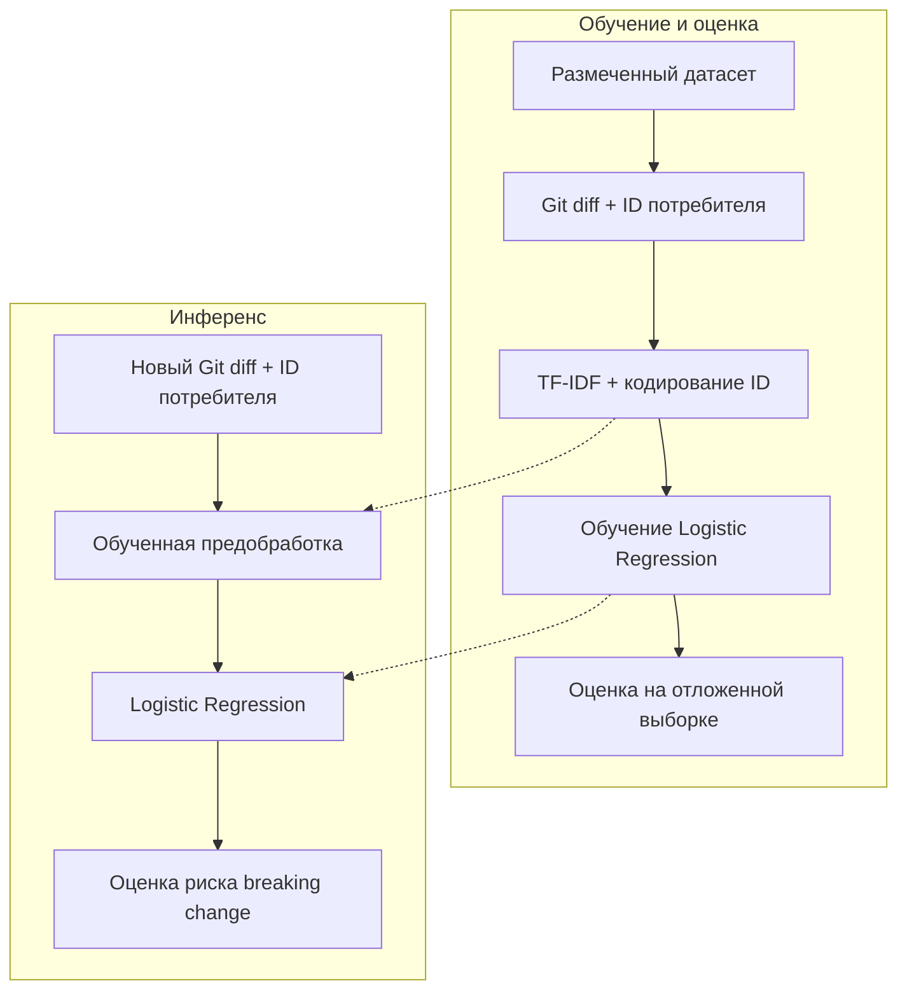
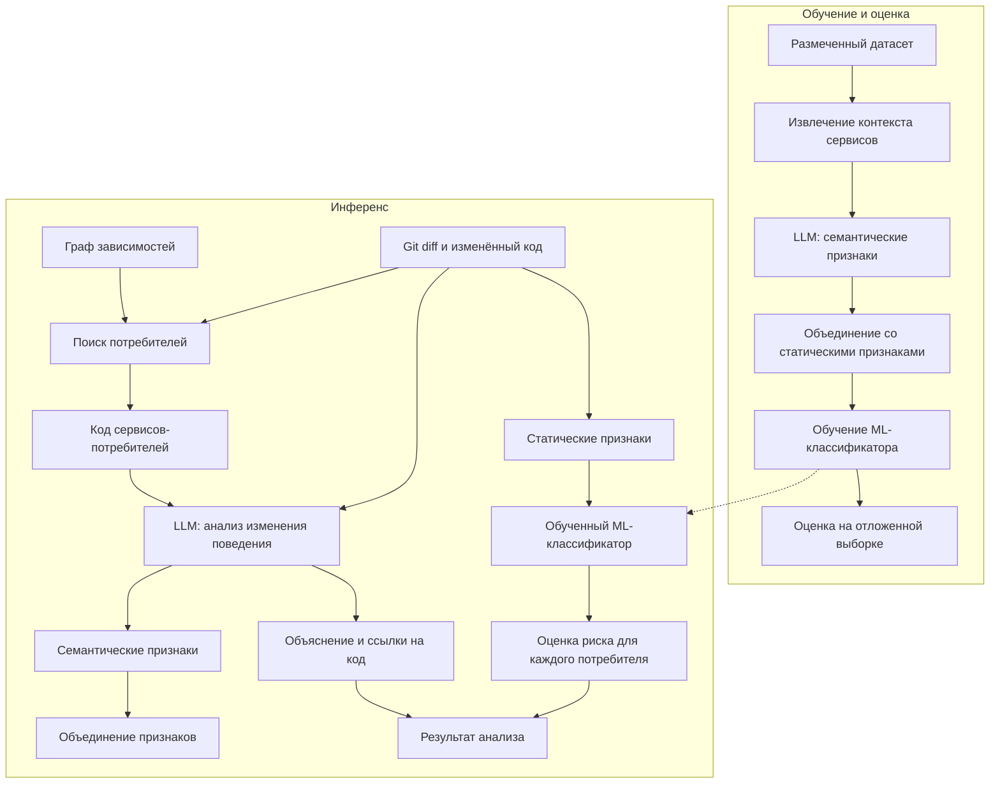

# ML System Design Doc - Semantic Firewall (MVP)

## Термины

| Термин | Определение |
|---|---|
| **Breaking change** | Изменение в сервисе, нарушающее совместимость с существующими потребителями и требующее адаптации их кода или поведения. |
| **Семантический breaking change** | Изменение поведения сервиса, нарушающее ожидания потребителей, даже если структура API осталась прежней. |
| **Поведенческий контракт** | Ожидаемое поведение сервиса, на которое полагаются его потребители. Например, возвращается ли стоимость товара с учётом налога. |
| **Сервис-поставщик (provider)** | Сервис, предоставляющий API или функциональность другим сервисам. |
| **Сервис-потребитель (consumer)** | Сервис, использующий API другого сервиса и зависящий от его поведения. |
| **Межсервисная регрессия** | Нарушение ранее корректного взаимодействия между сервисами после изменения одного из них. |

## 1. Цели и предпосылки

### 1.1. Зачем идём в разработку продукта?

В микросервисных системах изменение поведения одного сервиса может нарушить работу других, даже если API остаётся структурно совместимым.

Например, сервис расчёта стоимости начинает возвращать цену с налогом вместо цены без налога. Зависимый сервис продолжает добавлять налог самостоятельно. Структура API при этом не меняется, поэтому обычные проверки совместимости могут не обнаружить проблему.

Цель Semantic Firewall - выявлять потенциальные нарушения поведенческих контрактов между сервисами на этапе Code Review, до попадания изменений в основную ветку.

Существующие инструменты проверки API-контрактов в основном ориентированы на структурные изменения. Для обнаружения поведенческих нарушений нужно анализировать код изменённого сервиса и то, как его используют другие компоненты. LLM может помочь восстановить этот контекст и выделить признаки, которые сложно получить обычным статическим анализом.

Система предназначена для разработчиков микросервисных приложений. Польза заключается в более раннем обнаружении регрессий и сокращении времени на анализ влияния изменений.

MVP считаем успешным, если основная модель обнаруживает больше семантических breaking changes, чем baseline, при одинаковом ограничении на долю ложных срабатываний.

### 1.2. Бизнес-требования и ограничения

Основной сценарий использования - анализ Pull Request перед слиянием изменений. Система проверяет изменение и сообщает разработчику, какие сервисы могут пострадать и почему. Решение о слиянии остаётся за разработчиком.

**Функциональные требования:**

1. Принимать Git diff и получать связанные с ним версии исходного кода.
2. Определять потенциально затронутые сервисы на основе графа зависимостей.
3. Анализировать изменения поведения с использованием LLM.
4. Возвращать оценку риска семантического breaking change, затронутые сервисы и ссылки на соответствующие участки кода.

**Нефункциональные требования:**

- Приоритет - обнаружение семантических breaking changes при приемлемом количестве ложных срабатываний.
- Время и стоимость LLM-инференса не должны существенно затруднять использование системы в процессе Code Review.
- Обучение и оценка моделей должны быть воспроизводимыми.

**Ограничения:**

- Нет доступа к корпоративным репозиториям и истории production-инцидентов.
- Для MVP используются синтетические изменения в тестовой микросервисной системе.
- Первая версия ограничена Python-проектами.
- Система не исправляет код и не блокирует Pull Request автоматически.

В MVP вместо реального CI/CD будет использоваться имитация анализа PR на подготовленном наборе изменений. Конкретные пороги качества, времени и стоимости анализа определим после EDA и первых экспериментов.

### 1.3. Что входит в scope проекта/итерации, что не входит

**В MVP входит:**

- Разработка небольшой тестовой микросервисной системы.
- Создание размеченного датасета семантических breaking и non-breaking changes.
- EDA, обучение baseline и основной ML-модели.
- Использование LLM для извлечения семантических признаков.
- Оценка качества моделей на отложенной выборке.
- Реализация inference API и нагрузочное тестирование.

**Не входит в MVP:**

- Поддержка нескольких языков программирования.
- Автоматическое исправление ошибок.
- Интеграция с корпоративной CI/CD-инфраструктурой.
- Автоматическое построение зависимостей для произвольных репозиториев.
- Production-развёртывание с гарантированным SLA.

В рамках MVP реализуем оба подхода и сравним их на одном тестовом наборе.

Для упрощения первой версии граф зависимостей будет задан вручную, а LLM будет вызываться через внешний API.

### 1.4. Предпосылки решения

Для реализации MVP принимаем следующие предположения:

1. Зависимости между сервисами известны. На первом этапе их можно описать вручную.
2. По коду потребителя можно хотя бы частично восстановить ожидания от вызываемого API.
3. Изменения поведения можно воспроизвести и проверить с помощью интеграционных тестов.

В качестве источников данных будем использовать Git diff, исходный код сервисов, граф зависимостей и результаты интеграционных тестов.

Для получения датасета планируется создать небольшое e-commerce приложение из нескольких взаимодействующих сервисов. В него будут вноситься изменения, нарушающие или сохраняющие поведенческую совместимость.

**Разметка выполняется для конкретной пары `(изменение кода, сервис-потребитель)`.**

Для этого одни и те же интеграционные тесты будут запускаться с двумя версиями сервиса-поставщика при неизменном коде потребителя:

- Если старая версия проходит тесты, а новая воспроизводимо нарушает проверяемый поведенческий контракт, изменение помечается как breaking для данного потребителя.
- Если обе версии проходят проверки, изменение считается non-breaking в рамках проверяемых контрактов.
- Сценарии, для которых нельзя надёжно установить метку, исключаются из обучения.

Одно изменение может оказаться breaking для одного потребителя и non-breaking для другого. Результаты интеграционных тестов, используемых для разметки, не будут передаваться модели при предсказании.

Главная проблема синтетического датасета - модель может выучить шаблоны сгенерированных изменений вместо реальных признаков несовместимости. Поэтому потребуется разнообразие сценариев и проверка качества разметки.

Предсказание выполняется после изменения кода, но до его слияния в основную ветку.

## 2. Методология

### 2.1. Постановка задачи

Задача формулируется как бинарная классификация семантических breaking changes.

Единица предсказания - пара `(изменение кода, сервис-потребитель)`.

**Целевая переменная:**

- `y = 1` - изменение нарушает проверяемый поведенческий контракт с потребителем.
- `y = 0` - изменение сохраняет совместимость в рамках проверяемых контрактов.

Случаи, для которых нет достаточных данных о совместимости, исключаются из обучающей выборки.

В качестве baseline планируется использовать TF-IDF + Logistic Regression. На вход подаются Git diff и идентификатор сервиса-потребителя. Baseline не получает код потребителя и информацию о его поведении.

В основном решении LLM анализирует изменение и код потребителя, после чего извлекает структурированные семантические признаки. Они объединяются со статическими признаками изменения и передаются обучаемому классификатору. В качестве первого кандидата рассматривается CatBoost.

Основная гипотеза - использование семантических признаков и контекста зависимых сервисов улучшит качество классификации по сравнению с baseline.

**Метрики качества:**

| Метрика | Что оцениваем |
|---|---|
| Recall | Какую долю семантических breaking changes удалось найти |
| Precision | Какая доля предупреждений оказалась корректной |
| False Positive Rate | Как часто безопасные изменения ошибочно определяются как breaking |
| PR-AUC | Насколько хорошо модель ранжирует изменения по риску |

Основной критерий сравнения - Recall при одинаковом ограничении на False Positive Rate.

Данные разделим на train, validation и test. Варианты одного исходного сценария должны попадать в одну выборку, чтобы модель не оценивалась на почти идентичных изменениях, которые уже видела при обучении.

Окончательный выбор моделей, признаков и схемы валидации сделаем после EDA.

### 2.2. Блок-схема решения

**Baseline**

Baseline использует текст Git diff и идентификатор сервиса-потребителя без анализа его исходного кода.

**Основное решение**

Обе модели обучаются на размеченных изменениях и оцениваются на одинаковой отложенной выборке. В основном решении для каждой пары сервисов используется контекст потребителя, а результат включает оценку риска и объяснение потенциального нарушения.

### 2.3. Этапы решения задачи

#### Этап 1. Подготовка данных

Для MVP создан полностью синтетический датасет с изменениями поведения сервисов на Python. Для каждого изменения сохранены старая и новая версии provider, Git diff, код зависимых consumers и результаты контрактных проверок.

Единица наблюдения - пара `(изменение кода, потребитель)`.

Основные характеристики датасета:

| Характеристика | Значение |
|---|---:|
| Всего пар | 405 |
| Уникальных Git diff | 81 |
| Семейств изменений | 27 |
| Типов изменений | 11 |
| Сервисов-поставщиков | 9 |
| Сервисов-потребителей | 23 |
| Зависимостей между сервисами | 54 |
| Breaking changes | 281 |
| Non-breaking changes | 124 |

Каждое изменение проверяется на пяти потребителях. Для каждого потребителя предусмотрены три контрактных случая.

В датасете представлены изменения расчётов, единиц измерения, округления, граничных условий, сортировки, статусов, идемпотентности и обработки значений по умолчанию.

Основные сущности данных:

| Сущность | Содержимое | Назначение |
|---|---|---|
| Изменение кода | Git diff, старый и новый код provider | Вход модели |
| Потребитель | Имя и исходный код consumer | Контекст для оценки совместимости |
| Граф зависимостей | Связи provider и consumer | Определение затронутых сервисов |
| Метаданные пары | ID, пути к файлам, характеристики diff | EDA и подготовка признаков |
| Метка `label` | `0` или `1` | Обучение и оценка |
| Контрактные проверки | Тестовые входы и результаты выполнения | Формирование и проверка меток |

Основная таблица находится в `data/processed/pairs.csv`. Исходный код и Git diff хранятся отдельно, пути к ним записаны в таблице.

Генерация и разметка

Датасет создан программно из набора сценариев. Для каждого сценария генерируются старая и новая реализации provider и несколько consumers с разными ожиданиями от его поведения.

**Качество данных и результаты EDA**

В ходе EDA проверены объём данных, баланс классов, типы изменений, размеры Git diff, зависимости между сервисами, пропуски, дубликаты и корректность разбиения.

Основные результаты:

- Пропусков и дубликатов по парам `(scenario_id, consumer)` не обнаружено.
- Все ссылки на Git diff и исходные файлы существуют.
- На проверяемых входах структура ответов provider не меняется.
- 69,4% наблюдений относятся к классу breaking.
- Размер Git diff составляет от 232 до 541 символа, медиана - 342 символа.
- Один Git diff может нарушать контракт нескольких потребителей или оставаться совместимым с частью из них.

Главные проблемы данных:

1. Дисбаланс классов. Breaking-примеров больше, чем non-breaking. Поэтому accuracy может давать неверное представление о качестве модели.
2. Зависимые наблюдения. Один Git diff повторяется для пяти consumers. Случайное разбиение по строкам привело бы к утечке между train и test.
3. Небольшое количество независимых сценариев. В датасете 405 пар, но только 27 семейств изменений.
4. Синтетическое происхождение. Модель может запомнить особенности генератора. Кроме того, код и взаимодействия сервисов проще реальных микросервисов.
5. Ограниченность тестов. `label=0` означает совместимость на трёх проверенных случаях, а не на всех возможных входных данных.

Подробные таблицы, проверки и выводы приведены в [EDA.md](../EDA.md).

**Достаточность данных**

Текущего набора достаточно для EDA и первых экспериментов с baseline и основной моделью.

Для надёжной оценки качества данных пока мало. Особенно это касается test, где представлены только четыре независимых семейства изменений.

Планируется увеличить число семейств хотя бы до 60-80. При текущем способе генерации это потребует ещё примерно 500-800 пар.

При расширении нужно добавить более сложные изменения, новые варианты использования API и безопасные изменения, внешне похожие на breaking changes.

Окончательный необходимый объём будет определён после первых экспериментов с моделями. В дальнейшем для проверки применимости решения потребуются реальные изменения из открытых репозиториев или независимая экспертная разметка.

**Конфиденциальность**

Данные полностью синтетические. В них нет персональных данных, корпоративного кода, токенов и других секретов. Дополнительная анонимизация не требуется.

При переходе к реальным репозиториям потребуется проверять исходный код на конфиденциальные данные перед отправкой контекста во внешний LLM API.

**Результат этапа**

Подготовленный датасет, исходный код сценариев, Git diff, контрактные тесты, скрипт генерации, EDA-ноутбук и отчёт EDA.md.

Результаты тестов используются для формирования меток, но не передаются классификатору в качестве признаков.

#### Этап 2. Подготовка прогнозных моделей

**Метрики и функция потерь**

Основная задача - определить вероятность того, что изменение provider нарушит контракт конкретного consumer.

Для оценки используются:

| Метрика | Зачем нужна |
|---|---|
| Recall | Показывает долю найденных breaking changes |
| FPR | Показывает долю ложных предупреждений среди безопасных изменений |
| Precision | Показывает долю правильных предупреждений |
| PR-AUC | Показывает качество разделения классов при разных порогах |

Основная метрика сравнения - Recall при ограничении на FPR.

Высокий Recall важен, поскольку пропущенный breaking change может привести к регрессии после слияния PR. При этом FPR нельзя игнорировать: большое количество ложных предупреждений сделает систему неудобной для разработчиков.

Для обучения моделей используется логарифмическая функция потерь (лог лосс). Она подходит для бинарной классификации, когда на выходе нужна вероятность нарушения.

Порог для выдачи предупреждений подбирается на validation. Baseline и основная модель сравниваются при одном ограничении на FPR.

Точный допустимый FPR пока не зафиксирован. В validation всего 16 non-breaking примеров, поэтому даже одна ошибка заметно меняет значение метрики. Порог уточню после экспериментов и расширения набора.

**Разбиение и валидация**

По результатам EDA используется разбиение по `family_id`, а не по отдельным строкам.

| Выборка | Пар | Non-breaking | Breaking | Семейств |
|---|---: |---: |---: |---: |
| Train | 285 | 85 | 200 | 19 |
| Validation | 60 | 16 | 44 | 4 |
| Test | 60 | 23 | 37 | 4 |

Все варианты одного семейства изменений находятся в одной выборке.

Это необходимо, поскольку несколько примеров могут содержать одинаковые Git diff или близкие реализации одного изменения. При случайном разбиении модель могла бы встретить похожий код во время обучения и затем получить завышенную оценку на test.

Для подбора гиперпараметров планируется использовать групповую кросс-валидацию внутри train.

Validation используется для выбора модели и порога предупреждений. Test не используется при подборе параметров и остаётся для итоговой оценки.

Дополнительно буду смотреть результаты по отдельным семействам изменений. Общей метрики по 60 тестовым парам недостаточно, поскольку они относятся только к четырём семействам.

**Baseline**

В качестве baseline используется TF-IDF + логистическая регрессия.

На вход подаются Git diff и идентификатор сервиса-потребителя.

Предобработка:

1. Чтение Git diff из `diff_path`.
2. Преобразование текста в TF-IDF признаки.
3. Кодирование идентификатора consumer.
4. Объединение признаков и обучение логистической регрессии.

TF-IDF позволяет выделить характерные конструкции изменённого кода. Логистическая регрессия используется как простой и быстрый классификатор.

Преобразования обучаются только на train. На validation и test применяется уже обученная предобработка.

Планируется подобрать регуляризацию, параметры TF-IDF, веса классов и порог предупреждения.

Код consumer baseline не получает. Он нужен для основной модели, где проверяется гипотеза о пользе контекста зависимых сервисов.

Дополнительно использую простой контрольный вариант, который всегда предсказывает breaking. Он покажет, почему высокого Recall недостаточно без ограничения на FPR.

**Основная модель**

Основное решение использует контекст изменения и зависимого сервиса.

На вход подаются:

- Git diff;
- старая и новая версии provider;
- код consumer;
- информация о зависимости между сервисами;
- статические характеристики изменения.

LLM анализирует изменение поведения и то, как результат используется consumer. На выходе формируются структурированные семантические признаки.

Примеры признаков:

- тип изменения поведения;
- изменение единиц измерения, округления или порядка обработки;
- использование изменённого результата потребителем;
- наличие предположений о формате или значении результата;
- возможное противоречие между поведением provider и ожиданиями consumer;
- достаточность контекста для анализа.

Семантические признаки объединяются со статическими характеристиками Git diff.

В качестве первого классификатора рассматривается CatBoost. Он позволяет работать с числовыми и категориальными признаками и анализировать их влияние на предсказания.

Если данных окажется недостаточно для CatBoost, дополнительно проверю логистическую регрессию на тех же признаках.

**Развитие решения**

После обучения baseline планируется:

1. Получить семантические признаки через LLM.
2. Обучить CatBoost и сравнить его с baseline.
3. Проверить, улучшают ли семантические признаки качество относительно одних статических признаков.
4. Подобрать гиперпараметры на групповой валидации.
5. Провести анализ ошибок по типам и семействам изменений.

Отдельно проверю, не использует ли модель простые подсказки вместо анализа совместимости. Например, размер Git diff, имя consumer или тип изменения.

Поля `family_id`, `scenario_id`, `split`, результаты контрактных тестов и эталонные ответы не должны использоваться как признаки. Они предназначены для генерации, разметки и оценки датасета.

**Интерпретация результатов**

Ошибки буду разделять на false positive и false negative.

Наиболее интересны случаи, когда одно изменение нарушает контракт одного потребителя, но не влияет на другого. Именно они позволяют проверить, помогает ли основной модели контекст consumer.

Для CatBoost планируется анализ важности признаков. Для отдельных предсказаний буду сохранять используемые участки кода и объяснение возможного нарушения.

**Риски этапа**

- Переобучение на синтетических шаблонах. Использовать разбиение по семействам и расширять набор новыми сценариями.
- Утечка метки через тесты или метаданные генерации. Разделить данные для обучения и проверки разметки.
- Недостаточный объём независимых сценариев. Анализировать разброс метрик и не делать окончательных выводов по четырём тестовым семействам.
- Ошибки LLM при выделении признаков. Проверять формат ответа и сохранять исходный контекст для разбора ошибок.

**Результат этапа**

Обученный baseline, основная модель, сохранённая предобработка, выбранный порог предупреждения и сравнительный отчёт с метриками и анализом ошибок.

#### Этап 3. Извлечение семантических признаков через LLM

Этот этап нужен только для основного решения.

Задача LLM - определить, какое поведение изменилось в provider и может ли это изменение нарушить ожидания consumer.

**Входные данные:**

- Git diff;
- старая и новая реализации изменённого участка provider;
- связанный с ним код consumer;
- информация о зависимости между сервисами.

Контрактные тесты, результаты их выполнения и целевые метки в запрос к LLM не передаются.

**Процесс**

По графу зависимостей определяется потребитель изменённого сервиса. Затем из кода выбираются изменённые функции provider и участки consumer, которые используют их результат.

LLM получает этот контекст и возвращает структурированный JSON с семантическими признаками, кратким объяснением и ссылками на код.

Если по коду невозможно определить ожидание consumer, результат должен содержать признак недостаточного контекста. В таком случае LLM не должна придумывать контракт.

**Проверка результатов**

Для ответов LLM предусматриваются:

- проверка JSON и допустимых значений;
- проверка существования указанных файлов и строк кода;
- обработка ошибок и невалидных ответов;
- сохранение версии модели, промпта и параметров генерации;
- кэширование ответов для повторяющихся входных данных.

Исходный код и комментарии рассматриваются как данные, а не как инструкции для LLM. Это необходимо, чтобы текст внутри изменяемого PR не мог управлять процессом анализа.

**Результат этапа**

Модуль извлечения семантических признаков, который одинаково работает при подготовке обучающего датасета и во время инференса.

#### Этап 4. Подготовка инференса

Целевой сценарий - анализ Pull Request перед слиянием изменений.

На этапе MVP полноценная интеграция с GitHub Actions не требуется. Вместо неё реализую локальный анализ изменений из подготовленного датасета.

**Процесс:**

1. Получить Git diff и версии изменённого provider.
2. Определить зависимые consumers по графу зависимостей.
3. Для каждого consumer подготовить контекст.
4. Извлечь статические и семантические признаки.
5. Получить оценку риска от обученного классификатора.
6. Сформировать отчёт для разработчика.

Для baseline используется упрощённый процесс без LLM: Git diff и ID consumer сразу передаются в TF-IDF и логистическая регрессия.

**Формат результата**

Для каждого потребителя возвращаются:

- изменённый provider;
- затронутый consumer;
- вероятность нарушения контракта;
- итоговое предупреждение по выбранному порогу;
- краткая причина;
- ссылки на соответствующие участки кода.

Если анализ не удалось завершить из-за ошибки или недостаточного контекста, система возвращает отдельный статус. Такой случай не должен автоматически считаться безопасным.

На уровне всего PR дополнительно формируется общий результат: обнаружены ли потенциальные нарушения хотя бы для одного consumer.

**Производительность**

Для прототипа измерю время обработки одного изменения, полного PR и количество вызовов LLM.

Чтобы снизить задержки и стоимость, планируется ограничивать объём передаваемого кода и кэшировать результаты для одинаковых изменений.

Система не блокирует слияние PR и не исправляет код автоматически. Решение остаётся за разработчиком.

**Результат этапа**

Работающий локальный прототип анализа PR с оценками риска для зависимых сервисов и объяснениями предупреждений.

#### Этап 5. Проверка MVP

На этом этапе сравню baseline и основное решение на одинаковых отложенных сценариях.

Основной критерий - увеличение Recall при сопоставимом ограничении на FPR.

Дополнительно оценю Precision, PR-AUC, время анализа и количество вызовов LLM.

Помимо метрик для отдельных пар `(изменение, consumer)`, проверю результаты на уровне целого изменения:

- сколько изменений с реальными нарушениями удалось обнаружить;
- для скольких безопасных изменений система выдала хотя бы одно ложное предупреждение;
- сколько предупреждений приходится на одно изменение.

Это важно, поскольку один PR может затрагивать несколько сервисов. Даже небольшое количество ложных срабатываний на уровне отдельных пар может привести к большому числу предупреждений на уровне PR.

Отдельно разберу случаи, когда:

- breaking change не обнаружен;
- безопасное изменение ошибочно помечено как breaking;
- LLM неверно определила изменение поведения;
- consumer использует изменённый результат, но остаётся совместимым.

Результаты будут оцениваться с учётом ограничений синтетического датасета. Хорошее качество на текущем test покажет, что подход работает на подготовленных сценариях, но не докажет его эффективность на реальных микросервисах.

**Результат этапа**

Сравнительный отчёт по baseline и основной модели, анализ ошибок и вывод о том, помогает ли использование LLM и контекста consumer находить больше семантических breaking changes.
