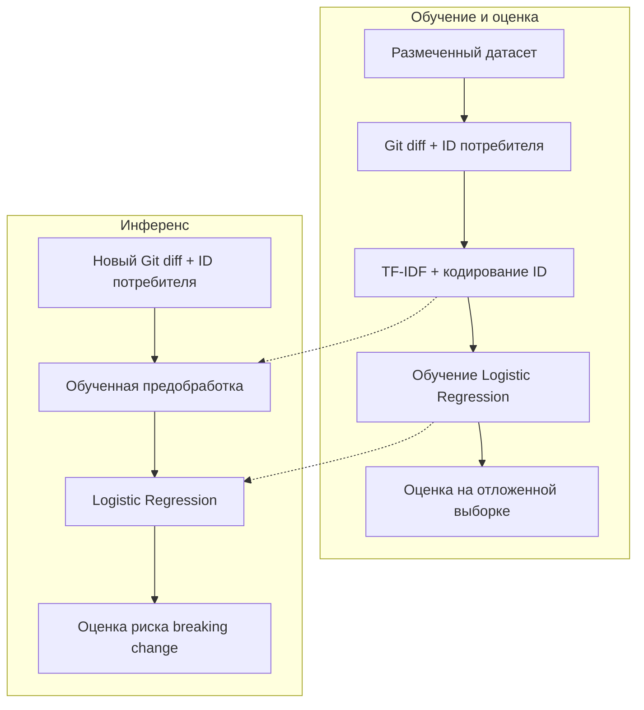
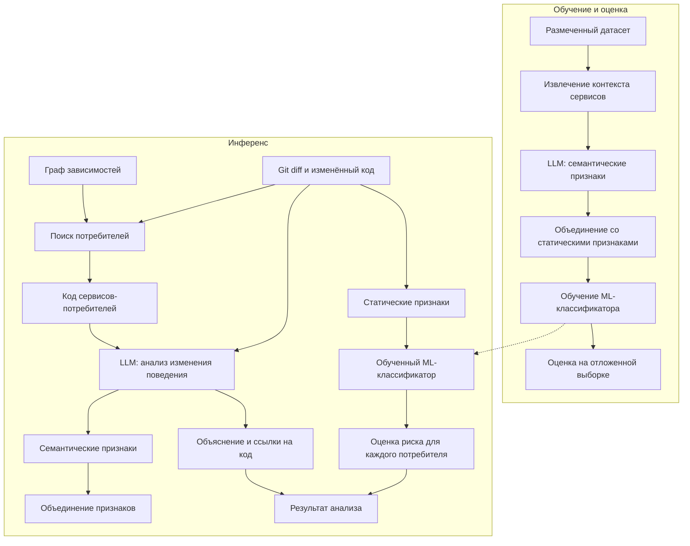

# ML System Design Doc - Semantic Firewall (MVP)

## Термины

| Термин | Определение |
|---|---|
| **Breaking change** | Изменение в сервисе, нарушающее совместимость с существующими потребителями и требующее адаптации их кода или поведения. |
| **Семантический breaking change** | Изменение поведения сервиса, нарушающее ожидания потребителей, даже если структура API осталась прежней. |
| **Поведенческий контракт** | Ожидаемое поведение сервиса, на которое полагаются его потребители. Например, возвращается ли стоимость товара с учётом налога. |
| **Сервис-поставщик (provider)** | Сервис, предоставляющий API или функциональность другим сервисам. |
| **Сервис-потребитель (consumer)** | Сервис, использующий API другого сервиса и зависящий от его поведения. |
| **Межсервисная регрессия** | Нарушение ранее корректного взаимодействия между сервисами после изменения одного из них. |

## 1. Цели и предпосылки

### 1.1. Зачем идём в разработку продукта?

В микросервисных системах изменение поведения одного сервиса может нарушить работу других, даже если API остаётся структурно совместимым.

Например, сервис расчёта стоимости начинает возвращать цену с налогом вместо цены без налога. Зависимый сервис продолжает добавлять налог самостоятельно. Структура API при этом не меняется, поэтому обычные проверки совместимости могут не обнаружить проблему.

Цель Semantic Firewall - выявлять потенциальные нарушения поведенческих контрактов между сервисами на этапе Code Review, до попадания изменений в основную ветку.

Существующие инструменты проверки API-контрактов в основном ориентированы на структурные изменения. Для обнаружения поведенческих нарушений нужно анализировать код изменённого сервиса и то, как его используют другие компоненты. LLM может помочь восстановить этот контекст и выделить признаки, которые сложно получить обычным статическим анализом.

Система предназначена для разработчиков микросервисных приложений. Польза заключается в более раннем обнаружении регрессий и сокращении времени на анализ влияния изменений.

MVP считаем успешным, если основная модель обнаруживает больше семантических breaking changes, чем baseline, при одинаковом ограничении на долю ложных срабатываний.

### 1.2. Бизнес-требования и ограничения

Основной сценарий использования - анализ Pull Request перед слиянием изменений. Система проверяет изменение и сообщает разработчику, какие сервисы могут пострадать и почему. Решение о слиянии остаётся за разработчиком.

**Функциональные требования:**

1. Принимать Git diff и получать связанные с ним версии исходного кода.
2. Определять потенциально затронутые сервисы на основе графа зависимостей.
3. Анализировать изменения поведения с использованием LLM.
4. Возвращать оценку риска семантического breaking change, затронутые сервисы и ссылки на соответствующие участки кода.

**Нефункциональные требования:**

- Приоритет - обнаружение семантических breaking changes при приемлемом количестве ложных срабатываний.
- Время и стоимость LLM-инференса не должны существенно затруднять использование системы в процессе Code Review.
- Обучение и оценка моделей должны быть воспроизводимыми.

**Ограничения:**

- Нет доступа к корпоративным репозиториям и истории production-инцидентов.
- Для MVP используются синтетические изменения в тестовой микросервисной системе.
- Первая версия ограничена Python-проектами.
- Система не исправляет код и не блокирует Pull Request автоматически.

В MVP вместо реального CI/CD будет использоваться имитация анализа PR на подготовленном наборе изменений. Конкретные пороги качества, времени и стоимости анализа определим после EDA и первых экспериментов.

### 1.3. Что входит в scope проекта/итерации, что не входит

**В MVP входит:**

- Разработка небольшой тестовой микросервисной системы.
- Создание размеченного датасета семантических breaking и non-breaking changes.
- EDA, обучение baseline и основной ML-модели.
- Использование LLM для извлечения семантических признаков.
- Оценка качества моделей на отложенной выборке.
- Реализация inference API и нагрузочное тестирование.

**Не входит в MVP:**

- Поддержка нескольких языков программирования.
- Автоматическое исправление ошибок.
- Интеграция с корпоративной CI/CD-инфраструктурой.
- Автоматическое построение зависимостей для произвольных репозиториев.
- Production-развёртывание с гарантированным SLA.

В рамках MVP реализуем оба подхода и сравним их на одном тестовом наборе.

Для упрощения первой версии граф зависимостей будет задан вручную, а LLM будет вызываться через внешний API.

### 1.4. Предпосылки решения

Для реализации MVP принимаем следующие предположения:

1. Зависимости между сервисами известны. На первом этапе их можно описать вручную.
2. По коду потребителя можно хотя бы частично восстановить ожидания от вызываемого API.
3. Изменения поведения можно воспроизвести и проверить с помощью интеграционных тестов.

В качестве источников данных будем использовать Git diff, исходный код сервисов, граф зависимостей и результаты интеграционных тестов.

Для получения датасета планируется создать небольшое e-commerce приложение из нескольких взаимодействующих сервисов. В него будут вноситься изменения, нарушающие или сохраняющие поведенческую совместимость.

**Разметка выполняется для конкретной пары `(изменение кода, сервис-потребитель)`.**

Для этого одни и те же интеграционные тесты будут запускаться с двумя версиями сервиса-поставщика при неизменном коде потребителя:

- Если старая версия проходит тесты, а новая воспроизводимо нарушает проверяемый поведенческий контракт, изменение помечается как breaking для данного потребителя.
- Если обе версии проходят проверки, изменение считается non-breaking в рамках проверяемых контрактов.
- Сценарии, для которых нельзя надёжно установить метку, исключаются из обучения.

Одно изменение может оказаться breaking для одного потребителя и non-breaking для другого. Результаты интеграционных тестов, используемых для разметки, не будут передаваться модели при предсказании.

Главная проблема синтетического датасета - модель может выучить шаблоны сгенерированных изменений вместо реальных признаков несовместимости. Поэтому потребуется разнообразие сценариев и проверка качества разметки.

Предсказание выполняется после изменения кода, но до его слияния в основную ветку.

## 2. Методология

### 2.1. Постановка задачи

Задача формулируется как бинарная классификация семантических breaking changes.

Единица предсказания - пара `(изменение кода, сервис-потребитель)`.

**Целевая переменная:**

- `y = 1` - изменение нарушает проверяемый поведенческий контракт с потребителем.
- `y = 0` - изменение сохраняет совместимость в рамках проверяемых контрактов.

Случаи, для которых нет достаточных данных о совместимости, исключаются из обучающей выборки.

В качестве baseline планируется использовать TF-IDF + Logistic Regression. На вход подаются Git diff и идентификатор сервиса-потребителя. Baseline не получает код потребителя и информацию о его поведении.

В основном решении LLM анализирует изменение и код потребителя, после чего извлекает структурированные семантические признаки. Они объединяются со статическими признаками изменения и передаются обучаемому классификатору. В качестве первого кандидата рассматривается CatBoost.

Основная гипотеза - использование семантических признаков и контекста зависимых сервисов улучшит качество классификации по сравнению с baseline.

**Метрики качества:**

| Метрика | Что оцениваем |
|---|---|
| Recall | Какую долю семантических breaking changes удалось найти |
| Precision | Какая доля предупреждений оказалась корректной |
| False Positive Rate | Как часто безопасные изменения ошибочно определяются как breaking |
| PR-AUC | Насколько хорошо модель ранжирует изменения по риску |

Основной критерий сравнения - Recall при одинаковом ограничении на False Positive Rate.

Данные разделим на train, validation и test. Варианты одного исходного сценария должны попадать в одну выборку, чтобы модель не оценивалась на почти идентичных изменениях, которые уже видела при обучении.

Окончательный выбор моделей, признаков и схемы валидации сделаем после EDA.

### 2.2. Блок-схема решения

**Baseline**

Baseline использует текст Git diff и идентификатор сервиса-потребителя без анализа его исходного кода.

**Основное решение**

Обе модели обучаются на размеченных изменениях и оцениваются на одинаковой отложенной выборке. В основном решении для каждой пары сервисов используется контекст потребителя, а результат включает оценку риска и объяснение потенциального нарушения.
